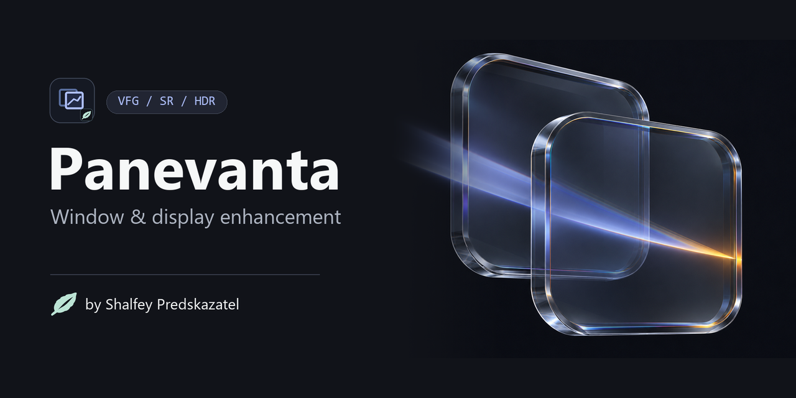

# Panevanta

**English** · [Русский](README.ru.md)

**Panevanta 0.9.7 is a portable Windows app that adds NVIDIA RTX video effects to a selected window or display.**

[Download for Windows x64](https://github.com/Shalfey-Predskazatel/Panevanta/releases/download/v0.9.7/Panevanta-0.9.7-Portable-win-x64.zip) · [Source code](Source/) · [Source archive](https://github.com/Shalfey-Predskazatel/Panevanta/releases/download/v0.9.7/Panevanta-0.9.7-Source.zip) · [Release notes and SHA-256](https://github.com/Shalfey-Predskazatel/Panevanta/releases/tag/v0.9.7)

Panevanta captures a selected window or display, processes its image, and presents it in an overlay. Streamer mode can send the processed output to a separate window for OBS. The source application remains responsible for video decoding and audio.

- NVIDIA Video Frame Generation, RTX Video Super Resolution, and RTX Video HDR.
- DLSS 5 Neural Rendering with selectable styles, processing sizes, and passes.
- Streamer output for OBS, automatic frame-rate tuning, and a compact control panel.
- Windows Graphics Capture with a native Direct3D 11 and CUDA processing engine.

Extract the complete portable ZIP and run `Program/Panevanta.exe`. Select a window or display and enable RTX. The default shortcut is **Shift + Alt + S**. The release archive contains the runtime files, third-party notices, and Russian quick-start guide.

The NVIDIA effects require a compatible RTX GPU and GeForce driver. Features and measured frame rates depend on the source, display, driver, and selected settings.

## Source and build

The 0.9.7 application is in [Source/Rust](Source/Rust/). It uses Rust and Tauri with a React interface and the native GPU engine in [Source/Native](Source/Native/). The earlier managed application is retained in [Source/Panevanta](Source/Panevanta/). Build notes for the current Rust application are in [English](Source/Rust/README.md) and [Russian](Source/Rust/README.ru.md).

The repository does not include the full offline toolchain or NVIDIA SDK payloads. Some rebuild steps require NVIDIA SDK components obtained under their applicable license. See [third-party notes](docs/third-party.md). The earlier .NET build procedure is marked as legacy in [Building](docs/building.md).

## License

Original Panevanta source code and build scripts are licensed under the [MIT License](LICENSE). The license does not cover product names, logos, artwork, or third-party components. See [third-party notes](docs/third-party.md) for component information.

Panevanta is an independent project and is not affiliated with or endorsed by NVIDIA or Microsoft. Product and company names identify compatible technologies.
