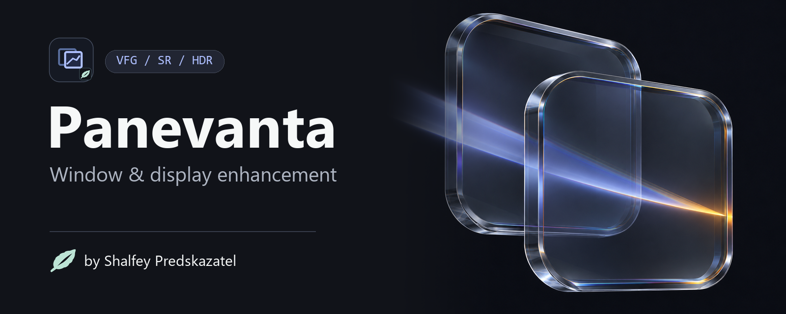

# Panevanta

**[Скачать Panevanta 0.7 для Windows x64](https://github.com/Shalfey-Predskazatel/panevanta/releases/download/v0.7/Panevanta-0.7-Portable-win-x64.zip)** · [Релиз и SHA-256](https://github.com/Shalfey-Predskazatel/panevanta/releases/tag/v0.7)

Переносимая сборка для Windows x64. Panevanta захватывает выбранное окно или монитор и выводит обработанное изображение поверх источника.

- NVIDIA VFG для генерации кадров, RTX Video Super Resolution и RTX Video HDR.
- Захват через Windows Graphics Capture, обработка на Direct3D 11 и CUDA.
- Для выбранных эффектов нужны совместимая NVIDIA RTX и актуальный драйвер GeForce.

Распакуйте ZIP целиком и запустите `Program/Panevanta.exe`. В комплекте есть зависимости, лицензии и инструкция `START-HERE.ru.md`.

Выберите окно или экран и нажмите **Включить RTX** (по умолчанию **Shift + Alt + S**).

[Как работает обработка](docs/how-it-works.ru.md)

by Shalfey Predskazatel
