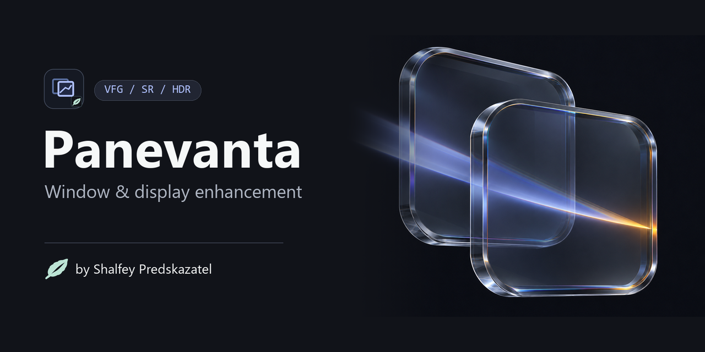

# Panevanta

[English](README.md) · **Русский**

**Panevanta 0.9.7 — portable-приложение для Windows, которое добавляет эффекты NVIDIA RTX выбранному окну или экрану.**

[Скачать для Windows x64](https://github.com/Shalfey-Predskazatel/Panevanta/releases/download/v0.9.7/Panevanta-0.9.7-Portable-win-x64.zip) · [Исходный код](Source/) · [Архив исходников](https://github.com/Shalfey-Predskazatel/Panevanta/releases/download/v0.9.7/Panevanta-0.9.7-Source.zip) · [Релиз и SHA-256](https://github.com/Shalfey-Predskazatel/Panevanta/releases/tag/v0.9.7)

Panevanta захватывает выбранное окно или монитор, обрабатывает изображение и выводит его поверх источника. Режим стримера передаёт обработанный результат в отдельное окно для OBS. Декодирование видео и звук остаются у исходного приложения.

- NVIDIA Video Frame Generation, RTX Video Super Resolution и RTX Video HDR.
- DLSS 5 Neural Rendering с выбором стиля, размера обработки и числа проходов.
- Вывод для OBS, автоматическая настройка частоты кадров и компактная панель управления.
- Захват Windows Graphics Capture и нативный движок обработки на Direct3D 11 и CUDA.

Распакуйте ZIP целиком и запустите `Program/Panevanta.exe`. Выберите окно или экран и нажмите **Включить RTX**. Комбинация по умолчанию — **Shift + Alt + S**. В релиз входят файлы среды выполнения, уведомления о сторонних компонентах и краткая русская инструкция.

Для эффектов NVIDIA нужна совместимая видеокарта RTX и драйвер GeForce. Возможности и фактическая частота кадров зависят от источника, дисплея, драйвера и выбранных настроек.

## Исходники и сборка

Исходный код приложения 0.9.7 находится в [Source/Rust](Source/Rust/). Оно использует Rust и Tauri с интерфейсом React и нативным GPU-движком из [Source/Native](Source/Native/). Предыдущая managed-версия приложения сохранена в [Source/Panevanta](Source/Panevanta/). Инструкция по текущей Rust-версии доступна на [английском](Source/Rust/README.md) и [русском](Source/Rust/README.ru.md).

В репозитории нет полного офлайн-комплекта инструментов и файлов NVIDIA SDK. Для некоторых шагов сборки нужны компоненты NVIDIA SDK, полученные по соответствующей лицензии. См. [заметки о сторонних компонентах](docs/third-party.ru.md). Предыдущая инструкция для .NET помечена как устаревшая в разделе [Сборка](docs/building.ru.md).

## Лицензия

Оригинальный исходный код Panevanta и скрипты сборки распространяются по [лицензии MIT](LICENSE). Она не распространяется на название продукта, логотипы, иллюстрации и сторонние компоненты. Информация о компонентах приведена в [заметках о сторонних компонентах](docs/third-party.ru.md).

Panevanta — независимый проект, не связанный с NVIDIA или Microsoft и не одобренный ими. Названия компаний и продуктов используются для описания совместимости.

